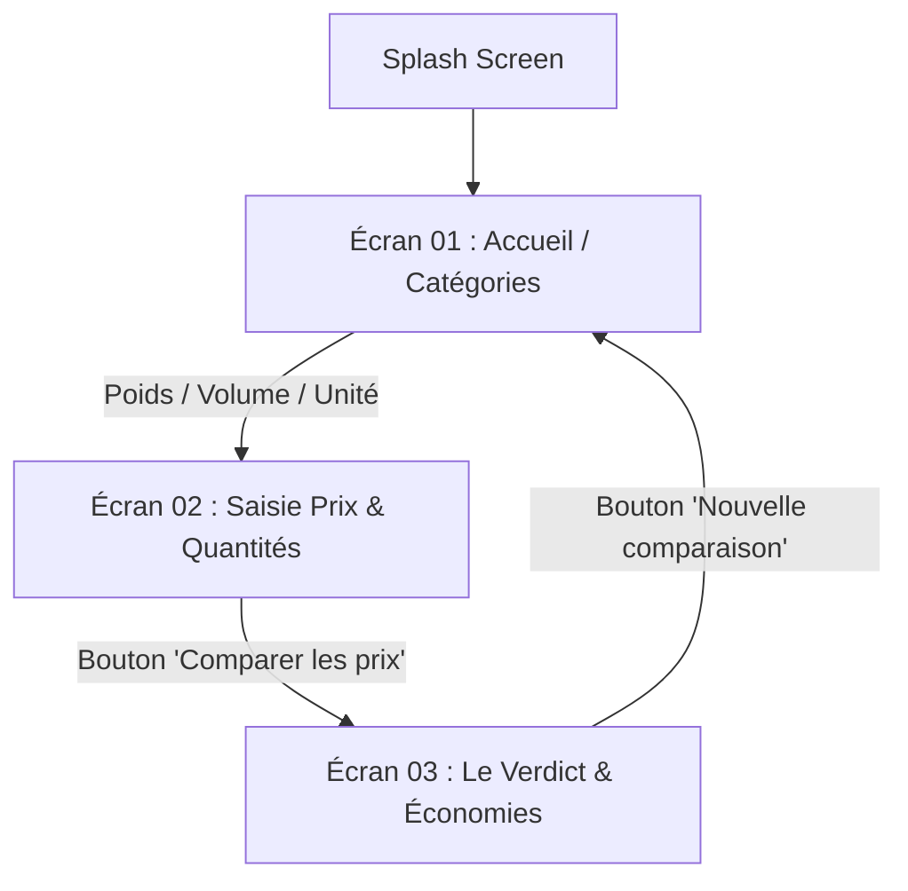

# 🛒 Scan & Compare

> *Le bon prix, à la bonne unité.*

---

## 📱 À propos de l'application

**Scan & Compare** est un outil d'aide à l'achat malin et intuitif conçu pour comparer instantanément le prix réel de deux produits (au kilo, au litre ou à l'unité/pack). 

Développé en **Java natif** dans le cadre d'une formation en développement mobile, l'application est conçue selon les principes modernes de **Material Design 3**, offrant une expérience utilisateur fluide, épurée et 100 % hors-ligne.

---

## ✨ Fonctionnalités Clés

* 🔒 **100 % Hors-ligne & Privé** : Aucune connexion Internet requise, aucune donnée personnelle collectée. Vos achats restent strictement confidentiels.
* ⚖️ **Comparaison par Poids** : Comparez facilement des produits en grammes (`g`) ou en kilogrammes (`kg`).
* 🧪 **Comparaison par Volume** : Comparez des liquides en millilitres (`ml`) ou en litres (`L`).
* 📦 **Comparaison à l'unité / Pack** : Comparez des lots, des packs ou des pièces individuelles avec un indicateur dynamique (*"Unités par pack"*).
* 💱 **Multi-devises intégrées** : Choisissez votre devise préférée directement depuis l'accueil (**EUR €**, **USD $**, **MAD DH**, **XOF F CFA**), mémorisée automatiquement.
* 🏆 **Le Verdict Intelligent** : Calcule automatiquement le prix unitaire de référence, identifie la meilleure offre, affiche l'option la plus chère et calcule le pourcentage ainsi que le montant exact économisé.

---

## 📸 Parcours Utilisateur (UI / UX Flow)

| Écran 01 : Accueil & Devises | Écran 02 : Saisie & Unités | Écran 03 : Le Verdict & Économies |
| :---: | :---: | :---: |
| *Choix de la catégorie et de la monnaie* | *Entrée des prix, quantités et packs* | *Résultat, gagnant et montant économisé* |

---

## 🛠️ Stack Technique

* **Langage** : Java (100 %)
* **Architecture** : Activités multiples orientées composants (`MainActivity`, `ComparisonActivity`, `activity_verdict`, `SplashActivity`)
* **UI / Design** : XML, Material Design 3 (`MaterialCardView`), Vector Drawables personnalisés, Grilles et Conteneurs flexibles (`LinearLayout`, `ScrollView`)
* **Stockage local** : `SharedPreferences` (pour la persistance du choix de la devise)

---

## 🚀 Installation & Lancement

1. Clonez ce dépôt ou téléchargez le projet.
2. Ouvrez **Android Studio**.
3. Importez le projet en tant que projet Gradle.
4. Connectez un appareil Android physique (mode développeur et débogage USB activés) ou lancez un émulateur.
5. Cliquez sur le bouton **Run (▶)** pour compiler et lancer l'application.

---

## 🎓 Projet Éducatif

Ce projet a été réalisé dans le cadre d'un parcours d'apprentissage rigoureux du développement d'applications mobiles Android natives, mettant l'accent sur :
* Le respect des maquettes de design (Figma).
* La rigueur de la structure XML et du code Java orienté objet.
* L'ergonomie mobile (Edge-to-Edge, claviers ajustables, ergonomie tactile).

---

*Développé avec passion pour faire les meilleurs achats au meilleur prix.* 🛍️
